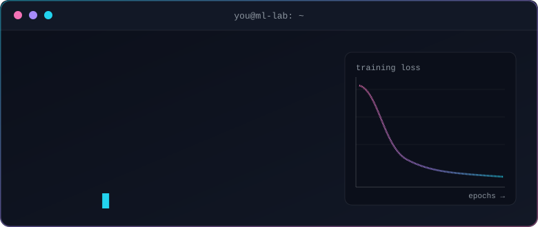
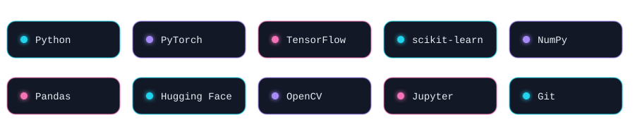

<!--
  QUICK EDIT CHECKLIST
  1. assets/header.svg   -> replace "Your Name" (and the 3 role lines if you like)
  2. assets/terminal.svg -> replace "Your Name" in the second line
  3. This file           -> replace YOUR_USERNAME, links, and the project cards
  4. Regenerate-free: every asset is plain SVG, so a text editor is all you need.
-->

<div align="center">



<br/>

<a href="https://www.linkedin.com/in/adithyakrishna11/"></a>
<a href="mailto:adithyakrishna2005bmv@gmail.com"></a>
<a href="https://leetcode.com/u/adithyakrz"></a>


<h2>&gt; whoami</h2>



</div>

<br/>

<div align="center">

```text
┌─ currently ──────────────────────────────────┐
│  learning  machine unlearning                │
│  building  Neural Network from Scratch       │
│  reading   papers, one coffee at a time      │
│  next up   reinforcement learning            │
└──────────────────────────────────────────────┘
```


<h2>&gt; ls ~/toolbox</h2>




<h2>&gt; cat projects.md</h2>

</div>

<table>
<tr>
<td width="33%" valign="top">

#### 🧠 CircuitCopilot
Automated AI circuit analysis and breadboard inspector powered by Meta AI models.

`FastAPI` · `Python` · `Meta AI`

[View repo →](https://github.com/adithyakrz/CircuitCopilot)

</td>
<td width="33%" valign="top">

#### 👁️ Facial Age Detection App
Facial age prediction engine built with fine-tuned ResNet50 achieving 91.4% accuracy.

`OpenCV` · `ResNet50` · `Keras`

[View repo →](https://github.com/adithyakrz/facial-age-detection)

</td>
<td width="33%" valign="top">

#### 💬 Bundesliga Predictor
Match outcome forecasting application driven by rolling form metrics and ML classifiers.

`scikit-learn` · `pandas` · `Streamlit`

[View repo →](https://github.com/adithyakrz/bundesliga-match-predictor)

</td>
</tr>
</table>

<div align="center">


<h2>&gt; tail -f learning.log</h2>

```text
loss
 │█▇
 │  ▆▅
 │    ▄▃▂
 │       ▂▁▁▁▁▁▁▁▁▁▁▁
 └─────────────────────── epochs
   fail  →  learn  →  repeat
```


</div>
